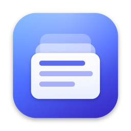

<p align="center">
  
</p>

<h1 align="center">CPStack</h1>

<p align="center">
  Удобная история буфера обмена в строке меню macOS — как <kbd>Win</kbd>+<kbd>V</kbd> в Windows.<br>
  Clipboard history in the macOS menu bar — like <kbd>Win</kbd>+<kbd>V</kbd> on Windows.
</p>

<p align="center">
  <a href="../../releases/latest">Скачать / Download</a>
</p>

---

## Возможности

- **⌘⇧V в любой программе** открывает стеклянную панель (Liquid Glass) прямо у текстового курсора. Сочетание можно поменять.
- **Вставка в один шаг**: выберите запись стрелками и нажмите ↩, или нажмите ⌘1…⌘9. CPStack сам вставит её в активное окно.
- **Текст, форматированный текст, картинки и файлы**: форматирование сохраняется, а ⇧↩ вставляет без него.
- **Поиск** по мере ввода, **закрепление** важных записей (⌘P) и удаление (⌘⌫).
- **Конфиденциальность**: пароли из менеджеров паролей не сохраняются, а запись можно приостановить. История хранится только локально.
- **Русский и английский** интерфейс: язык берётся из системы или выбирается в настройках.
- Цветовые коды (`#3A7BFF`) показываются с образцом цвета, ссылки и файлы получают свои значки.

### Горячие клавиши

| Клавиши | Действие |
|---|---|
| <kbd>⌘</kbd><kbd>⇧</kbd><kbd>V</kbd> | Открыть / закрыть историю |
| <kbd>↑</kbd> <kbd>↓</kbd> | Выбрать запись |
| <kbd>↩</kbd> | Вставить |
| <kbd>⇧</kbd><kbd>↩</kbd> | Вставить без форматирования |
| <kbd>⌘</kbd><kbd>1</kbd>…<kbd>9</kbd> | Вставить запись по номеру |
| <kbd>⌘</kbd><kbd>C</kbd> | Только скопировать, не вставляя |
| <kbd>⌘</kbd><kbd>P</kbd> | Закрепить / открепить |
| <kbd>⌘</kbd><kbd>⌫</kbd> | Удалить из истории |
| <kbd>⇥</kbd> | Только закреплённые |
| <kbd>⎋</kbd> | Очистить поиск / закрыть |
| <kbd>⌘</kbd><kbd>,</kbd> | Настройки |

Правый клик по значку в строке меню открывает меню: пауза, очистка, настройки, выход.

## Установка

1. Скачайте `CPStack-x.y.z.dmg` со страницы [Releases](../../releases/latest).
2. Откройте образ и перетащите **CPStack** в папку **Программы**.
3. Запустите CPStack. Если сборка не подписана сертификатом Apple, macOS покажет предупреждение. Тогда откройте **Системные настройки → Конфиденциальность и безопасность** и нажмите **«Всё равно открыть»**.
4. Чтобы CPStack мог сам вставлять текст, разрешите ему **Универсальный доступ**. Программа попросит об этом при первой вставке, разрешение также можно выдать в её настройках.

Требования: macOS 26 Tahoe или новее.

## Сборка из исходников

Достаточно Xcode 26+ или даже одних Command Line Tools (`xcode-select --install`).

```bash
make app       # build/CPStack.app
make run       # собрать и запустить
make dmg       # build/CPStack-<версия>.dmg с оформленным окном
make install   # скопировать в /Applications и запустить
```

Для `make dmg` нужен `python3`: скрипт сам поставит [dmgbuild](https://github.com/dmgbuild/dmgbuild) в локальное окружение `build/.venv`.

> **Совет для разработки.** Без сертификата приложение подписывается ad-hoc, и после каждой пересборки macOS считает его новой программой. Поэтому разрешение на Универсальный доступ приходится выдавать заново: удалите CPStack из списка кнопкой «−» и добавьте снова. Избавиться от этого можно, если подписывать сборку постоянным сертификатом: `CODESIGN_IDENTITY="Apple Development: …" make app`.

### Структура проекта

```
Sources/CPStack/
  App/          точка входа, AppDelegate, значок в строке меню
  Clipboard/    модель записи, чтение/запись NSPasteboard, хранилище истории
  Hotkey/       глобальная горячая клавиша (Carbon), раскладки клавиатуры
  Panel/        стеклянная панель: NSPanel + SwiftUI, поиск, вставка
  Settings/     окно настроек, запись сочетания клавиш
  Support/      язык интерфейса, Универсальный доступ, автозапуск
Resources/      Info.plist, иконка, переводы (en.lproj, ru.lproj)
Scripts/        сборка .app и .dmg, генерация иконки и фона DMG
```

История хранится в `~/Library/Application Support/CPStack`.

Публикация на GitHub и автоматические релизы описаны в [docs/PUBLISHING.md](docs/PUBLISHING.md).

Лицензия: [MIT](LICENSE).

---

## English

**CPStack** keeps everything you copy (text, rich text, images and files) and brings it back with **⌘⇧V**, right at your text cursor, in a minimal Liquid Glass panel. Pick an item with the arrow keys and press ↩, or press ⌘1…⌘9, and it is pasted into the app you were using. ⇧↩ pastes without formatting, ⌘P pins an item, and typing searches the history. Password-manager content is never recorded, and all data stays on your Mac.

**Install:** download the DMG from [Releases](../../releases/latest), drag CPStack to Applications, launch it, and grant Accessibility access when asked so CPStack can paste for you. Requires macOS 26 Tahoe or later.

**Build:** `make app`, `make run` or `make dmg` (Xcode 26+ or the Command Line Tools).
